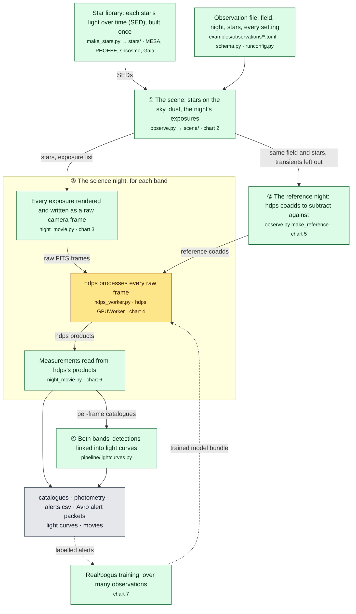
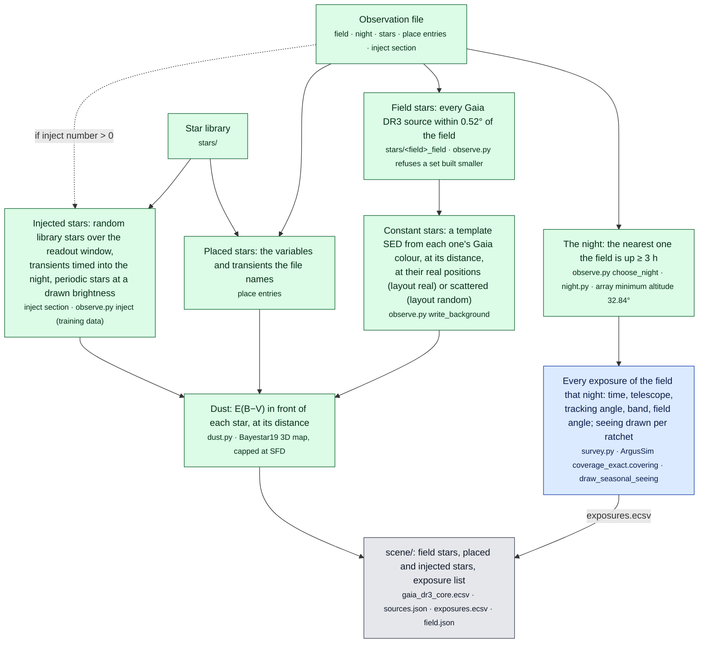
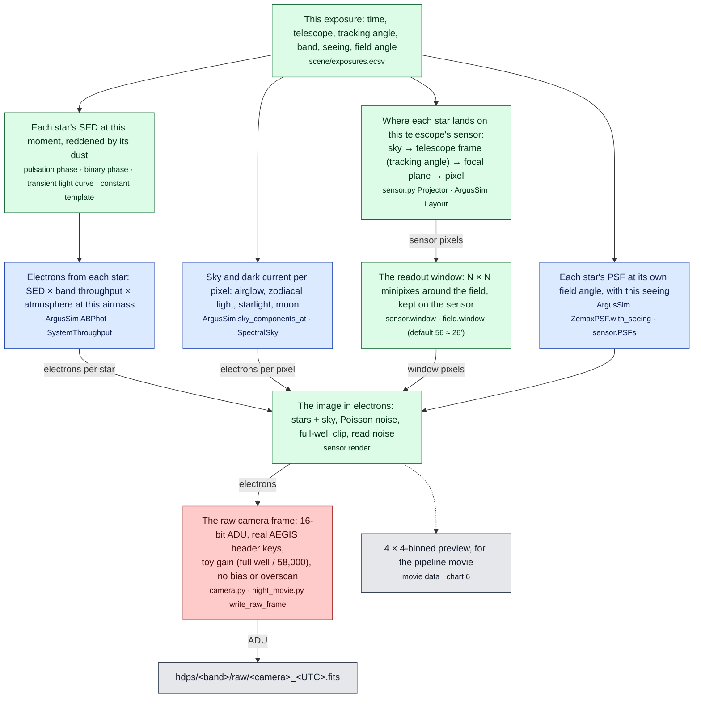
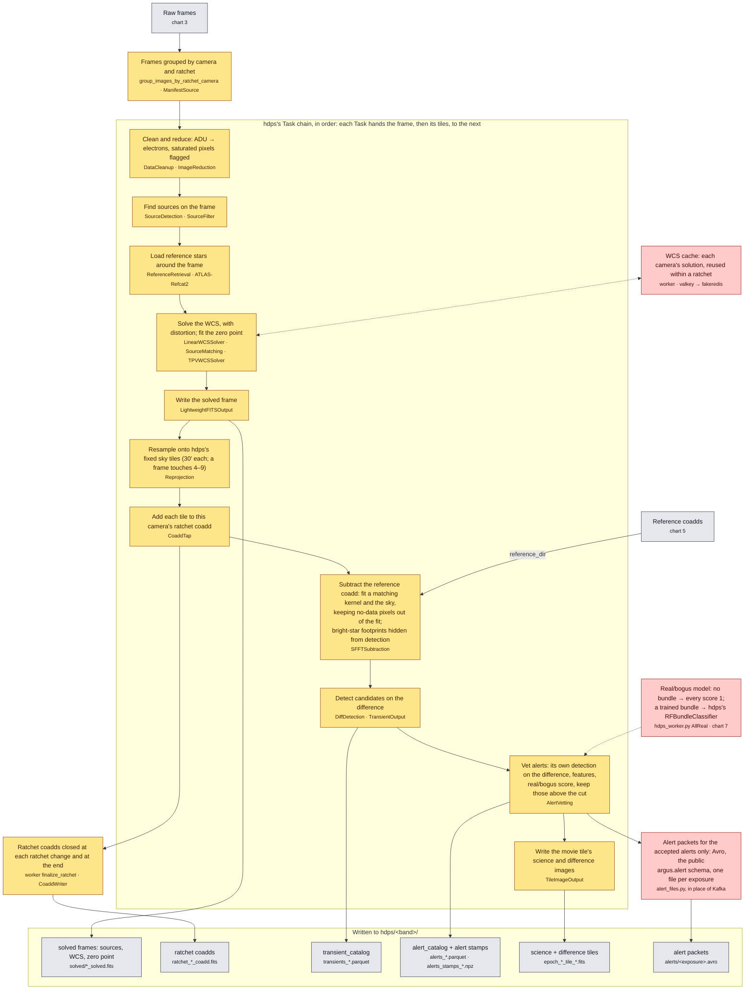
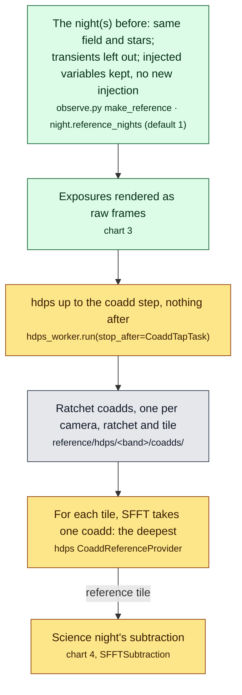
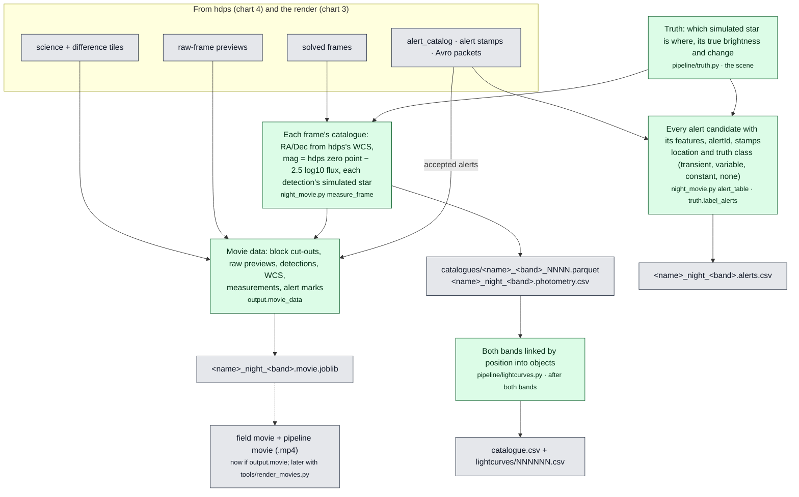
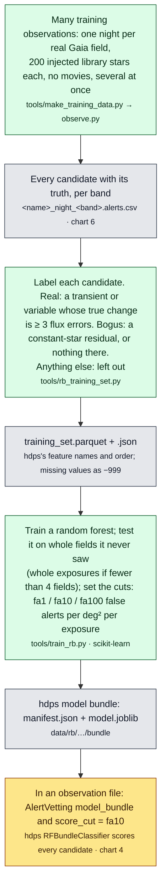

# The pipeline, as flow charts

How one observation is made, from the stars to the alerts, and how the real/bogus model is trained. Plain-text
Mermaid: GitHub, VS Code and Obsidian draw it.

**How to read them**

- A box is a step: what it does in plain words, then (small) the code that does it.
- An arrow carries what is handed on; its label names that data.
- A dashed arrow is optional or later (a setting turns it on, or it happens in another run).
- Circled numbers give the order things happen in.

| Colour | Who owns the step |
|---|---|
| blue | ArgusSim (the Argus instrument, site and survey model) |
| green | MESA_ARGUS (this repository) |
| amber | hdps (the Argus pipeline), run unchanged |
| red | a stand-in, where hdps or Argus has no real piece yet |
| grey | a file written |

Charts:

1. [Overview: one observation, start to finish](#1-overview-one-observation-start-to-finish)
2. [The scene: stars on the sky and the night's exposures](#2-the-scene-stars-on-the-sky-and-the-nights-exposures)
3. [One exposure: from the sky to a raw camera frame](#3-one-exposure-from-the-sky-to-a-raw-camera-frame)
4. [hdps on every frame](#4-hdps-on-every-frame)
5. [The reference night](#5-the-reference-night)
6. [Measurements and outputs](#6-measurements-and-outputs)
7. [Real/bogus: training the model and using it](#7-realbogus-training-the-model-and-using-it)

## 1. Overview: one observation, start to finish

`python observe.py <observation file>` does all of it. Each band (β, ρ) runs as its own process, both at once.

## 2. The scene: stars on the sky and the night's exposures

`observe.py`, before anything is rendered. Everything it decides is written to `scene/`, which the engine reads.

## 3. One exposure: from the sky to a raw camera frame

`night_movie.py`, once per exposure in the band. Only a readout window of the telescope's sensor around the field is
made, not the whole 11,648 × 8,742 px sensor.

## 4. hdps on every frame

hdps's own worker (`GPUWorker`) running hdps's production Task chain, unchanged, on the CPU through the
`hdps_full_cpu` branch. One worker per band. The chain and every setting are `[[hdps.tasks]]` in the observation file.
A frame that a Task fails on is skipped; the rest carry on.

## 5. The reference night

What SFFT subtracts against. Made only when `output.alerts` is on (the default), before the science night.

## 6. Measurements and outputs

Per band, `night_movie.py` reads hdps's products once its worker has finished; after both bands, `observe.py` links
the light curves. hdps's bulky per-frame files (raw frames, solved frames, tile images) are deleted once read, unless
`output.raw` is on.

## 7. Real/bogus: training the model and using it

Without a model every candidate scores 1, so every star that subtracts imperfectly becomes an alert. The simulation
knows what is real, so it can make the training set.

## Editing

- **A new step:** add a box with its colour class, and arrows in and out. Write what it does first, then the code in
  `<small>`; label each arrow with the data handed on.
- **A stand-in replaced by the real thing** (a trained model, real camera electronics, a valkey server, Kafka): change
  its class from `toy` to `hdps` or `ours`.
- **Keep the overview small.** Detail belongs in the stage charts.
- **Check it renders** before committing: `npx -y @mermaid-js/mermaid-cli -i docs/PIPELINE.md -o /tmp/pipeline.md`
  writes one image per chart.
