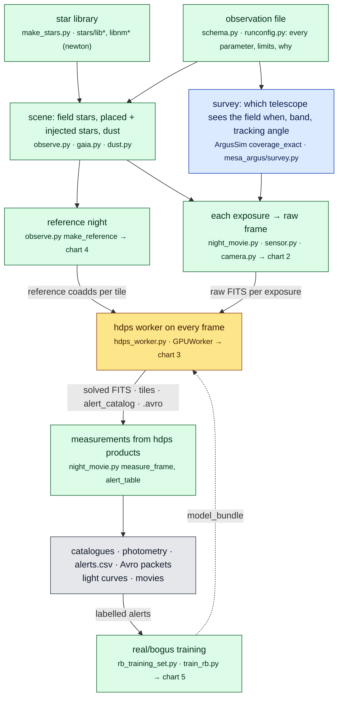
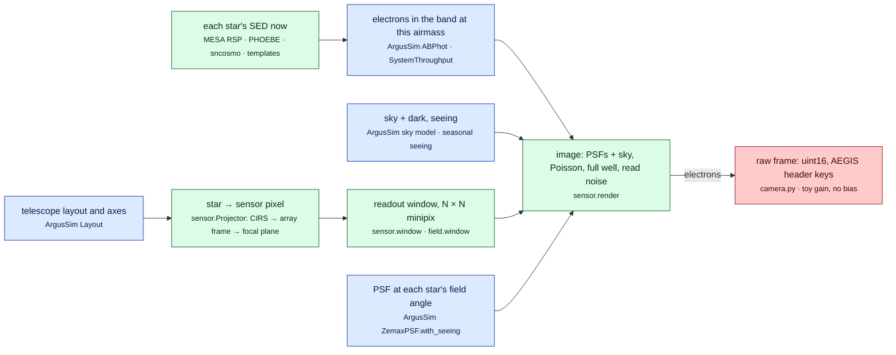
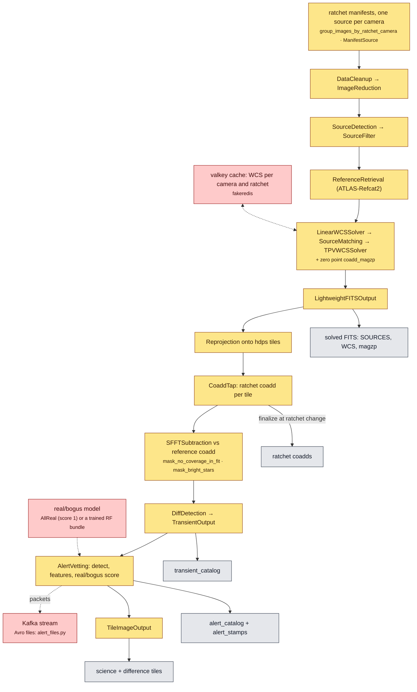
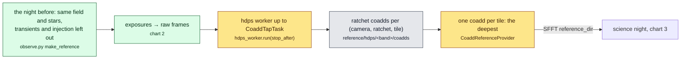
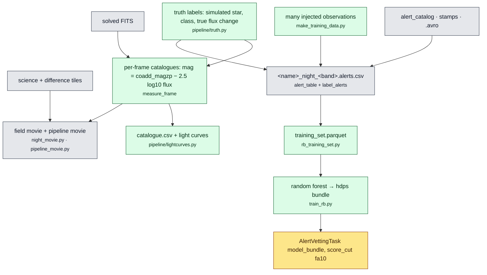

# The pipeline, as flow charts

Plain-text Mermaid: GitHub, VS Code and Obsidian draw it. To edit, change the text; to add a step, add a node and an
arrow. Every box names the code that does it; arrows carry the data handed on.

**Colours (who owns each step):**

| Colour | Owner |
|---|---|
| blue | ArgusSim |
| green | MESA_ARGUS (ours) |
| amber | hdps |
| red | stand-ins, where hdps or Argus has no piece yet |
| grey | outputs |

Charts:
1. Overview
2. One exposure: from the sky to a raw frame
3. hdps: the Task chain on each frame
4. The reference night
5. Outputs, truth and real/bogus training

## 1. Overview

## 2. One exposure: from the sky to a raw frame

## 3. hdps: the Task chain on each frame

All of it is hdps's own code, run by its `GPUWorker` on the CPU through the `hdps_full_cpu` branch. The chain is
`[[hdps.tasks]]` in the observation file.

## 4. The reference night

## 5. Outputs, truth and real/bogus training

## Editing

- **A new step:** add a node with the right colour class, and arrows in and out. Write the code in `<small>`, and
  the data handed on as the arrow's label.
- **A stand-in replaced by the real thing** (a trained model, real camera electronics): change its class from `toy`
  to `hdps` or `ours`.
- **Keep the overview small.** Detail goes in the stage charts.
